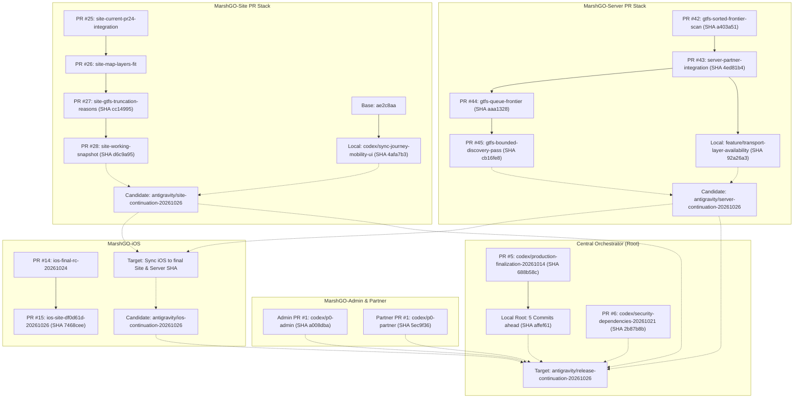

# MARSHGO — CANONICAL PR DEPENDENCY DAG (26.10.2026)

This document tracks the active pull requests, parent-child lineages, candidate heads, and integration targets across all six canonical MARSHGO repositories.

---

## Detailed PR Ancestry Breakdown

### 1. MarshGO-Server
- **PR #45** (`codex/gtfs-bounded-discovery-pass-20261026`, HEAD `cb16fe83...`):
  - Solves two-day-old GTFS service date instances (supporting up to 71:59:59 time horizons).
  - Parent: **PR #44** (`codex/gtfs-queue-frontier-20261026`, HEAD `aaa1328f...`):
    - Memory-bounded GTFS search frontier and queue limits.
  - Parent: **PR #43** (`codex/server-partner-integration-20261026`, HEAD `4ed81b47...`):
    - Admin/Partner audit event feed integration endpoint.
  - **Local Worktree** (`feature/transport-layer-availability`, HEAD `92a26a3`):
    - Contains recent commits:
      - `92a26a3`: `test(routing): cover calendar and realtime transfer parity`
      - `6cef355`: `fix(fares): refresh verified Lviv tariff metadata`
    - Contains 40 dirty files with critical routing, live journey, and test logic.
  - **Action**: Unify PR #45 with local `92a26a3` changes into branch `antigravity/server-continuation-20261026` via safe cherry-pick / merge without touching dirty worktree.

### 2. MarshGO-Site
- **PR #28** (`codex/site-working-snapshot-20261026`, HEAD `d6c9a957...`):
  - Integrates verified route, MapLibre layer sheet, rendezvous UX, and truncation notices.
  - Parent: **PR #27** (`codex/site-gtfs-truncation-reasons-20261025`, HEAD `cc149957...`).
  - **Local Worktree** (`codex/sync-journey-mobility-ui`, HEAD `4afa7b3`):
    - Contains 2 commits: `1a92201` (transit mode colors) and `4afa7b3` (geolocation fallback guidance).
    - Contains 80 dirty files (`JourneyRouteMapScreen.tsx`, `ProductionMarketplace.tsx`, `MapLibreAdapter.ts`).
  - **Action**: Merge PR #28 with local changes into `antigravity/site-continuation-20261026`.

### 3. MarshGO-iOS
- **PR #15** (`codex/ios-site-df0d61d-20261026`, HEAD `7468cee5...`):
  - Currently pinned to older Site SHA `df0d61d`.
  - **Action**: Keep pinned until Server and Site reach finalized, tested candidate SHAs, then re-pin and run simulator CI.

### 4. MarshGO-Admin & Partner
- **Admin PR #1** (`codex/p0-admin`, SHA `a008dba`):
  - Clean local state. Verified audit event integration with Server PR #43.
- **Partner PR #1** (`codex/p0-partner`, SHA `5ec9f36`):
  - Clean local state. Onboarding and organization settings verified.

### 5. MarshGO Central Orchestrator
- **PR #5** (`codex/production-finalization-20261014`, Origin SHA `688b58c`):
  - Local HEAD `affef61` is 5 commits ahead.
  - 376 dirty/untracked files (including test logs, audit documentation, and baseline images).
- **PR #6** (`codex/security-dependencies-20261021`, Origin SHA `2b87b8b`):
  - Contains npm platform lock metadata preservation and stale Compose context rejection.
  - Must be integrated into the central candidate.
- **Root Release Blocker**: Missing `MARSHGO_REPOS_READ_TOKEN` GitHub secret preventing root workflow from cloning private Admin/Partner repositories.
